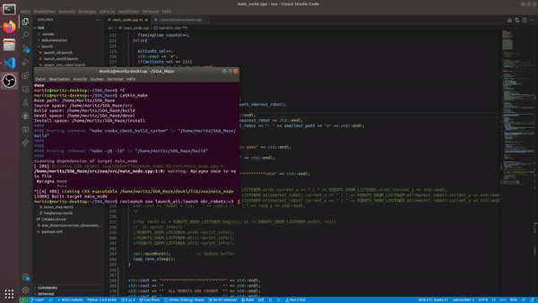
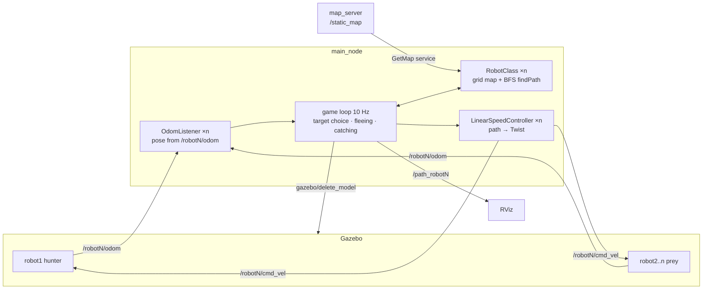
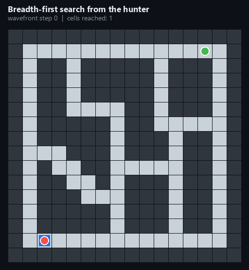
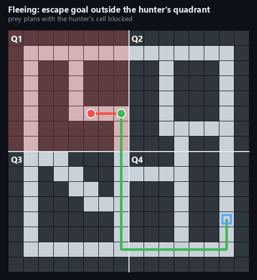

# Multi-Robot Chase in ROS + Gazebo



*A hunter TurtleBot3 plans a path through a maze to the nearest prey robot while the prey flee to another quadrant. Caught robots are deleted from the simulation.*

**ROS 1 Melodic · Gazebo · C++ · Python · catkin**

---

## What it does

`n` TurtleBot3 robots spawn at random free cells of a 16 × 16 maze in Gazebo.

- **Robot 0 is the hunter.** Every control cycle it plans a shortest path to each living prey robot and chases the nearest one, switching targets when another robot gets closer.
- **The prey flee.** When the hunter gets close, the targeted robot picks a random free goal *outside the hunter's quadrant* and plans an escape path that treats the hunter's cell as an obstacle.
- **Catching.** When the hunter's path to its target is shorter than two cells, the target is caught: it is removed from the Gazebo world and from the controller, so dead robots never block anyone.
- The game ends when every prey robot is caught. Game stats (current target, distance, quadrants, alive/caught list) print to the terminal each cycle; paths are shown in RViz.

## Architecture



| Component | File | Role |
|---|---|---|
| `main_node` | `src/soa/src/main_node.cpp` | Spawns robots and runs the game loop: nearest-target selection, fleeing goals, catch detection, game stats |
| `RobotClass` | `RobotClass.cpp/.hpp` | Loads the occupancy grid from `/static_map` and plans paths with breadth-first search |
| `LinearSpeedController` | `LinearSpeedController.cpp/.hpp` | Turns the next path waypoint into linear and angular velocity commands |
| `OdomListener` | `OdomListener.cpp/.hpp` | Subscribes to each robot's odometry and stores position and orientation |
| Map generator | `src/soa/map_generator/` | Python: writes the maze as a PNG for `map_server` and as a Gazebo world made of boxes (`boxes_map.world`) |

## How it works

**Path planning.** The map is a 16 × 16 grid in which every cell has a node ID. `RobotClass::findPath` runs a breadth-first search over free cells (4-connected, no diagonals) to fill a distance array from the start node, then walks back from the goal along decreasing distances to build a `nav_msgs/Path`. All moves cost the same, so BFS gives the shortest path, and its length doubles as the "distance" used to pick the nearest prey.

<p align="center"></p>

**Fleeing.** The map is split into four quadrants. When the hunter's path to the prey is short enough, the prey draws a random free cell in a different quadrant from the hunter (re-drawn on a timer). It plans its path with the hunter's current cell marked as an obstacle, so it does not run through the hunter. Robots that aren't being chased stand still.

<p align="center"></p>

**Control.** `LinearSpeedController` steers to the next waypoint. It computes the heading error from the odometry quaternion, turns fast for large errors and slowly for small ones, and creeps forward while the heading error is large. `speed_factor` scales the hunter's linear speed relative to the prey.

## Build and run

Requirements: Ubuntu 18.04, **ROS Melodic** with Gazebo, `turtlebot3_description`, `map_server`, `xacro`, and `gnome-terminal` (used to spawn robots and to delete caught ones).

```bash
git clone https://github.com/Abdulhamid-Baghdadi/turtlebot-maze-chase.git ~/turtlebot_maze_chase
cd ~/turtlebot_maze_chase/src && catkin_init_workspace && cd ..
catkin_make
source devel/setup.bash
roslaunch soa launch_all.launch nbr_robots:=3
```

Optional `speed_factor` (hunter speed / prey speed, default `2`): below 1 the prey are faster, 1 is equal, above 1 the hunter is faster.

```bash
roslaunch soa launch_all.launch nbr_robots:=4 speed_factor:=1.5
```

To change the maze, edit the array in `map_generator.py` (and the matching array in `main_node.cpp`), then run the script from `src/soa/map_generator/`.

## Team and contribution

A two-person university project in mobile robotics by **Moritz Abdank** and **Abdulhamid Baghdadi**. Moritz wrote about 70 % of the commits, including much of the core implementation, and is a full co-author of this work. This repository is a cleaned-up copy of our original project repository, without course material and commit history.

The demo GIF was recorded with the quadrant rule switched off to show a quick match.
